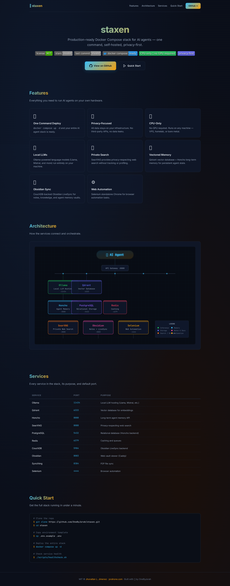
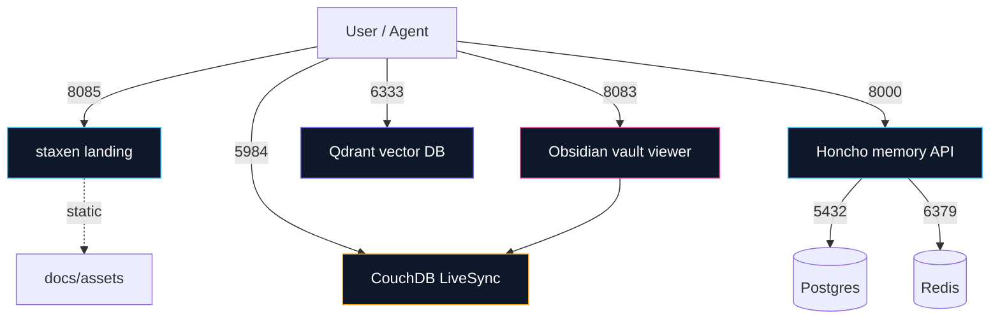

<div align="center">


# staxen

<sub>Formerly StackForge</sub>

## CPU-only, self-hosted Docker Compose stack for AI agents — local LLM, vector search, long-term memory, and synced notes

[](https://github.com/OneByJorah/staxen/actions/workflows/ci-cd.yml)
[](https://github.com/OneByJorah/staxen/releases)
[](https://github.com/OneByJorah/staxen/pkgs/container/staxen)
[](https://www.docker.com/)
[](https://docs.docker.com/compose/)
[](https://ollama.com/)
[](https://qdrant.tech/)
[](https://www.cpu-only.ai/)
[](https://opensource.org/licenses/MIT)

</div>



## What This Is

staxen bundles the infrastructure an AI agent needs to run privately on your own hardware: a local LLM via Ollama, a Qdrant vector database, Honcho long-term memory, SearXNG private search, an Obsidian-compatible notes vault with CouchDB LiveSync, Syncthing file sync, and a Selenium browser for automation. It is built for CPU-only machines — a VPS, homelab, or bare-metal box — and keeps all agent context off third-party servers.

**Formerly StackForge.** The project was renamed to staxen to match the published GHCR image and the `OneByJorah/staxen` repository.

## Quick Start

```bash
git clone https://github.com/OneByJorah/staxen.git
cd staxen
cp .env.example .env
docker compose up -d --build
./scripts/healthcheck.sh localhost
```

Open the core services on `localhost`:

| Service | URL |
| --- | --- |
| Landing page | <http://localhost:8085> |
| Obsidian vault viewer | <http://localhost:8083> |
| Honcho memory API | <http://localhost:8000/health> |
| Qdrant dashboard | <http://localhost:6333/dashboard> |
| CouchDB / Fauxton | <http://localhost:5984/_utils> |

To start the optional services too (SearXNG, Syncthing, Selenium, Ollama):

```bash
docker compose --profile full up -d --build
STACK_PROFILE=full ./scripts/healthcheck.sh localhost
```

For an interactive first-run wizard, run `bash bootstrap.sh` instead.

## Profiles

- **Core (default)** — everything you need to store, search, and sync agent memory:
  `staxen` landing page, Qdrant, Honcho (Postgres + Redis), CouchDB LiveSync, Obsidian vault viewer.
- **Full (`--profile full`)** — adds SearXNG, Syncthing, Selenium, and Ollama.
  Use this when you want search, P2P sync, browser automation, and local inference.

## Features

- **One-command core deploy** — `docker compose up -d --build`
- **Local LLM** — Ollama-based, CPU-only inference, no GPU required (full profile)
- **Vector database** — Qdrant for embeddings and semantic search
- **Persistent memory** — Honcho-backed long-term memory API
- **Private search** — Self-hosted SearXNG (full profile)
- **Synced notes vault** — Obsidian-compatible vault with CouchDB LiveSync and Syncthing (full profile)
- **Browser automation** — Selenium standalone Chrome (full profile)
- **CPU-only** — Runs on any VPS or homelab server
- **Privacy-first** — All agent context stays on your hardware

## Tech Stack

- **Orchestration** — Docker Compose (core + optional profiles)
- **LLM** — Ollama (CPU inference)
- **Vector DB** — Qdrant
- **Memory** — Honcho (Postgres + Redis)
- **Search** — SearXNG
- **Notes / sync** — Obsidian vault, CouchDB LiveSync, Syncthing
- **Browser** — Selenium
- **Landing page** — nginx static container built from this repo

## Configuration

Copy `.env.example` to `.env` and adjust the values. Core services start with the defaults shown below.

| Variable | Default | Description |
| --- | --- | --- |
| `SERVER_IP` | `localhost` | Host IP used in SearXNG base URLs |
| `SVC_STAXEN_PORT` | `8085` | Landing page port |
| `SVC_OBSIDIAN_PORT` | `8083` | Obsidian vault viewer port |
| `SVC_QDRANT_PORT` | `6333` | Qdrant REST / dashboard port |
| `SVC_HONCHO_PORT` | `8000` | Honcho API port |
| `SVC_HONCHO_DB_PORT` | `5432` | Postgres admin port (loopback only) |
| `SVC_HONCHO_REDIS_PORT` | `6379` | Redis admin port (loopback only) |
| `SVC_COUCHDB_PORT` | `5984` | CouchDB / Fauxton port |
| `HONCHO_DB_PASSWORD` | `changeme` | Postgres password for Honcho |
| `HONCHO_TOKEN` | `changeme` | API token placeholder |
| `COUCHDB_ADMIN_PASSWORD` | `changeme` | CouchDB admin password |
| `COUCHDB_SYNC_PASSWORD` | `changeme` | CouchDB sync-user password |

For interactive setup, run `bash bootstrap.sh` — it generates secrets, sets `SERVER_IP`, and seeds the vault.

## Architecture



## Services

| Service | Port | Profile | Purpose |
| --- | --- | --- | --- |
| `staxen` | `8085` | core | Static landing page |
| `obsidian` | `8083` | core | Web vault viewer (Caddy) |
| `qdrant` | `6333` | core | Vector database |
| `honcho-api` | `8000` | core | Long-term memory API |
| `honcho-db` | `5432` | core | Postgres backend for Honcho |
| `honcho-redis` | `6379` | core | Cache / queue backend |
| `livesync` | `5984` | core | CouchDB LiveSync backend |
| `searxng` | `8080` | full | Private web search |
| `syncthing` | `8384` | full | P2P file sync |
| `webautomation` | `4444` | full | Selenium browser automation |
| `ollama` | `11434` | full | Local LLM inference |

## Screenshots

See the running core stack in `docs/screenshots/`:

| Screen | File |
| --- | --- |
| Landing page | `docs/screenshots/landing.png` |
| Obsidian vault viewer | `docs/screenshots/vault.png` |
| Qdrant dashboard | `docs/screenshots/qdrant.png` |
| CouchDB Fauxton | `docs/screenshots/fauxton.png` |

## Contributing

Contributions are welcome. [Open an issue](https://github.com/OneByJorah/staxen/issues) to report a bug or request a feature.

## Security

See [SECURITY.md](SECURITY.md) for reporting vulnerabilities.

## License

MIT — see [LICENSE](LICENSE).
